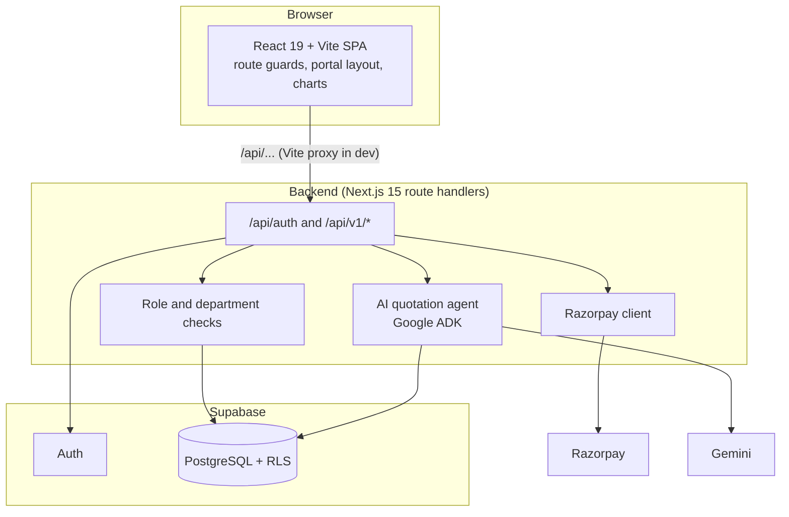
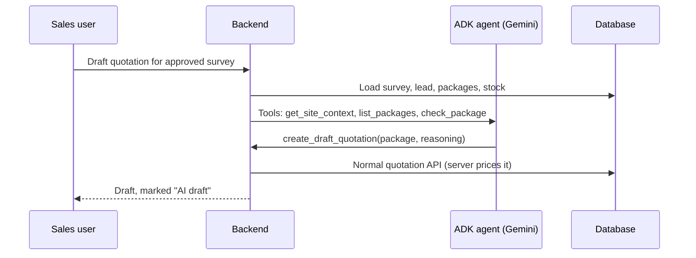

<div align="center">

# ☀️ SOLVIX

### One platform for the whole journey of a rooftop-solar project

Enquiry → site survey → AI-drafted quotation → online payment → warehouse → installation → warranty → finance.
Every team works in its own dashboard, all on the same live data.


</div>

---

## Table of contents

1. [What SOLVIX does](#1-what-solvix-does)
2. [The workflow at a glance](#2-the-workflow-at-a-glance)
3. [Who uses it (roles and portals)](#3-who-uses-it-roles-and-portals)
4. [Feature highlights](#4-feature-highlights)
5. [Architecture](#5-architecture)
6. [Quick start](#6-quick-start)
7. [Configuration reference](#7-configuration-reference)
8. [Demo data and a guided test run](#8-demo-data-and-a-guided-test-run)
9. [Running several copies side by side](#9-running-several-copies-side-by-side)
10. [Project layout](#10-project-layout)
11. [How the main pieces work](#11-how-the-main-pieces-work)
12. [Testing](#12-testing)
13. [Deploying to Vercel](#13-deploying-to-vercel)
14. [Known limitations](#14-known-limitations)
15. [Troubleshooting](#15-troubleshooting)
16. [Documentation index](#16-documentation-index)

---

## 1. What SOLVIX does

Installing solar involves many teams that normally work in separate spreadsheets: sales, surveyors, warehouse,
installers, support and accounts. SOLVIX puts them in **one system**. A record created in one step is the starting
point of the next, so nothing is retyped and the customer can see their own project at every stage.

| For the business | For the customer |
|---|---|
| One pipeline from first enquiry to profit report | Own portal: quotations, orders, installation progress, warranty |
| Each department sees only its own tools | Pay a quotation online, in full or in part |
| Every action recorded in an activity log | Raise service requests against a warranted product |
| AI agent drafts quotations from approved surveys | Track equipment from dispatch to installation |

---

## 2. The workflow at a glance

```mermaid
flowchart LR
    A[Customer enquiry<br/>website or WhatsApp] --> B[Lead<br/>Sales follows up]
    B --> C[Site survey<br/>engineer inspects roof]
    C --> D{Approved?}
    D -- yes --> E[Quotation<br/>manual or AI draft]
    E --> F[Customer accepts<br/>and pays via Razorpay]
    F --> G[Order confirmed]
    G --> H[Warehouse<br/>reserve, pack, serials]
    H --> I[Dispatch and delivery<br/>warranty starts]
    I --> J[Installation<br/>checklist, tests, sign-off]
    J --> K[Support and warranty claims]
    G --> L[Finance and subsidy]
    K --> L
```



| # | Step | Who | Where |
|--:|------|-----|-------|
| 1 | Enquiry | Customer / Sales | `/get-quote`, WhatsApp enquiries |
| 2 | Lead management | Sales | `/sales/leads`, follow-ups |
| 3 | Site survey and approval | Survey engineer, Admin/Manager | `/survey/*` |
| 4 | Quotation (manual or AI draft) | Sales, Admin | `/sales/quotations` |
| 5 | Customer accepts and pays | Customer | `/customer/quotations` |
| 6 | Order, packing, dispatch, delivery | Warehouse | `/warehouse/*` |
| 7 | Installation | Installation team | `/installation/*`, `/technician/*` |
| 8 | Warranty and after-sales | Customer, Support | `/customer/warranty`, `/support/*` |
| 9 | Finance, subsidy, reports | Finance, Subsidy, Admin | `/finance/*`, `/subsidy/*`, `/admin/*` |

The full step table is in [docs/workflow.md](docs/workflow.md).

---

## 3. Who uses it (roles and portals)

Each user type signs in at its own address. The backend checks the password with Supabase **and** that the account
really belongs to that portal, so a customer can never open an admin screen.

| Portal | Sign-in | Lands on | Typical users |
|---|---|---|---|
| Administrator | `/login/admin` | `/admin/dashboard` | Company owner, approves staff |
| Sales | `/login/sales` | `/sales/dashboard` | Sales and CRM team |
| Technician | `/login/technician` | `/technician/dashboard` | Survey engineers, installers |
| Operations | `/login/staff` | first module they hold | Warehouse, support, accounts, subsidy |
| Customer | `/login/customer` | `/customer/dashboard` | Homeowners and businesses |

**Accounts**
- `admin`: created only with `database/02_bootstrap_admin.sql`.
- `customer`: self-registers at `/signup` and confirms their email.
- `employee`: self-registers at `/register/employee`, then an Admin must **approve** them and assign a department
  (and optionally the Manager role) under **People & Access**. Until then they only see a "pending approval" page.

**Departments** are Sales & CRM, Site Survey & Engineering, Installation & Technical Operations, Warehouse &
Logistics, Support & Warranty, Accounts & Finance, and Subsidy & Documentation. A **Manager** role unlocks
management actions inside the person's own department (for example adding products or purchase orders in Warehouse).

---

## 4. Feature highlights

### 🧭 One dashboard per team
Clean card-based dashboards with charts (striped bars, tick-ring donuts, trend lines), a pinned sidebar, and a
**light / dark mode** toggle that remembers your choice. Charts are dependency-free SVG components in
`src/components/charts.jsx`.

### 🤖 AI quotation agent (Google ADK + Gemini)
After a survey is approved, **Draft this quotation with AI** reads the survey, picks the best catalogue package,
checks the roof limit and warehouse stock, and saves a **draft** for a person to review. Prices and tax are always
calculated by the server from the catalogue; the model only chooses what to quote and explains why. Without a Gemini
key it runs in a rule-based mode, so it works out of the box. See [11.1](#111-ai-quotation-agent).

### 💳 Online payments (Razorpay)
Customers can pay a quotation **in full or in part**. Amounts are checked on the server, the payment signature is
verified, and Razorpay is asked to confirm the payment before it is recorded. See [11.2](#112-payments).

### 📦 Real warehouse operations
Products, stock, purchase orders (with receiving), order packing with serial numbers, dispatch and delivery. Stock
leaves the warehouse exactly once, and **delivery starts the warranty clock**.

### 📷 QR / barcode scanning
Serial numbers can be scanned with the camera (html5-qrcode) while registering equipment and in the serial lookup.

### 🔐 Security by default
Role and department checks on every API call, Row Level Security on every table, no development bypass, and a
CORS allow-list. Secrets live only in environment variables.

---

## 5. Architecture



| Layer | Technology | Notes |
|---|---|---|
| Frontend (repo root) | React 19, React Router 6, Axios, Vite, lucide-react, html5-qrcode | Single-page app, code-split per page |
| Backend (`backend/`) | Next.js 15 route handlers (REST API) | Port 3001, an npm workspace |
| Data | Supabase PostgreSQL, Auth, Row Level Security | One schema file builds everything |
| AI | Google ADK (`@google/adk`) with Gemini | Draft-only, optional |
| Payments | Razorpay Checkout (test mode) | No SDK, plain REST + HMAC |

In development the frontend calls `/api/...` and Vite forwards it to the backend, so there is no CORS to configure.

---

## 6. Quick start

**Prerequisites:** Node.js 20+, npm, a free [Supabase](https://supabase.com) project.

### Step 1: Database
1. In Supabase open **SQL Editor** and run `database/solvix_schema.sql`.
2. Create the administrator in **Authentication → Users**, then run `database/02_bootstrap_admin.sql`
   (edit the email inside it first). Details are in [database/README.md](database/README.md).

### Step 2: Backend settings
```powershell
copy backend\.env.example backend\.env.local
```
Fill in `SUPABASE_URL`, `SUPABASE_ANON_KEY` and `SUPABASE_SERVICE_ROLE_KEY`. Never commit `.env.local`.
Razorpay and Gemini keys are optional for a first run (see [section 7](#7-configuration-reference)).

### Step 3: Run
```powershell
npm install
npm run dev
```

| What | Address |
|---|---|
| Frontend | http://localhost:5173 |
| Backend API | http://localhost:3001 |

Sign in at http://localhost:5173/login/admin with the admin you created.

---

## 7. Configuration reference

All settings are environment variables in `backend/.env.local` (copy of `backend/.env.example`).

| Variable | Required | Purpose |
|---|:--:|---|
| `SUPABASE_URL` | ✅ | Project URL (Project Settings → API) |
| `SUPABASE_ANON_KEY` | ✅ | Public key used to verify user tokens |
| `SUPABASE_SERVICE_ROLE_KEY` | ✅ | Server-only key for database access. **Never expose it** |
| `RAZORPAY_KEY_ID` / `RAZORPAY_KEY_SECRET` | for payments | Use `rzp_test_...` keys while testing |
| `GOOGLE_API_KEY` | optional | Gemini key from [AI Studio](https://aistudio.google.com/apikey); without it the AI agent uses rules |
| `GEMINI_MODEL` | optional | Defaults to `gemini-3.5-flash-lite` |
| `AI_QUOTATION_ENABLED` | optional | `false` turns the AI button off completely |
| `FRONTEND_ORIGIN` | for hosting | Allowed browser origins (comma separated). Defaults to `http://localhost:5173` |
| `FINANCE_MAX_STAFF_DISCOUNT_PERCENT` | optional | Largest invoice discount staff may give without a manager (default 10) |
| `NEXT_DIST_DIR` | optional | Separate build folder, used for [multiple copies](#9-running-several-copies-side-by-side) |

Frontend (Vite) variables:

| Variable | Purpose |
|---|---|
| `VITE_API_BASE_URL` | Only when the backend is on another address, e.g. `https://api.example.com/api/v1` |
| `VITE_PROXY_TARGET` | Dev only: which backend the Vite proxy forwards to (default `http://localhost:3001`) |

---

## 8. Demo data and a guided test run

Two files help you show the project quickly:

| File | What it is |
|---|---|
| [`TESTING_GUIDE.md`](TESTING_GUIDE.md) | A step-by-step script with the accounts and sample data for every role, from enquiry to reports. Includes a 5-minute pitch order |
| [`database/seed_demo_data.sql`](database/seed_demo_data.sql) | Adds about 10 realistic records to each dashboard (customers, leads, surveys, quotations, orders, payments, tickets, invoices, subsidy...) |
| [`database/seed_demo_cleanup.sql`](database/seed_demo_cleanup.sql) | Removes exactly the rows the seed added (everything coded `DEMO`) |

Run the seed in the Supabase SQL Editor. Every demo row has a `DEMO` code, so it is safe to run twice and easy to remove.

> The warehouse **stock** is separate from the seed. To pack and dispatch the demo orders, give the catalogue some stock
> (the testing guide has a one-line SQL for it).

---

## 9. Running several copies side by side

Useful for demoing several roles at once. Each copy is a frontend plus its own backend on different ports:

| Copy | Frontend | Backend |
|---|---|---|
| 1 | http://localhost:5173 | http://localhost:3001 |
| 2 | http://localhost:5174 | http://localhost:3002 |
| 3 | http://localhost:5175 | http://localhost:3003 |
| 4 | http://localhost:5176 | http://localhost:3004 |
| 5 | http://localhost:5177 | http://localhost:3005 |
| 6 | http://localhost:5178 | http://localhost:3006 |

Copy 1 is the normal `npm run dev`. For copy 2 (PowerShell, from the repo root):

```powershell
$env:NEXT_DIST_DIR = '.next-2'; $env:FRONTEND_ORIGIN = 'http://localhost:5174'; $env:VITE_PROXY_TARGET = 'http://localhost:3002'
npx concurrently -n api,web "cd backend && npx next dev --turbopack --port 3002" "npx vite --port 5174 --strictPort"
```

Each backend needs its own build folder (`NEXT_DIST_DIR`) and its frontend's address in `FRONTEND_ORIGIN`. Never run a
production `next build` in `backend/` while a dev server is running; it overwrites the dev server's cache.

---

## 10. Project layout

```text
.
├─ src/                          React frontend
│  ├─ App.jsx                    routes only (wrapped in an error boundary)
│  ├─ pages/
│  │  ├─ Landing.jsx             public website
│  │  ├─ auth/                   one sign-in page per user type, forgot/reset password
│  │  ├─ admin/                  overview, people & access, reports, activity log, catalogue
│  │  ├─ sales/                  leads, follow-ups, customers, quotations, orders
│  │  ├─ survey/                 requests, assignments, schedule, approvals, inspection form
│  │  ├─ installation/           jobs, technicians, schedule
│  │  ├─ technician/             "My day" for field staff
│  │  ├─ warehouse/              products, stock, purchase orders, packing, serials, dispatch
│  │  ├─ support/                tickets, warranties, claims
│  │  ├─ finance/  subsidy/      dashboards
│  │  └─ customer/               customer portal and online payment
│  ├─ components/                PortalLayout, route guards, charts, PaymentCard, QR scanner
│  ├─ config/navigation.js       sidebar menu for every user type
│  ├─ context/auth.jsx           signed-in user and session
│  ├─ theme/                     light/dark variables, dashboard skin, toggle
│  └─ services/api/              one API wrapper per module
├─ backend/                      Next.js API
│  ├─ app/api/auth/              sign in, register, refresh, password reset
│  ├─ app/api/enquiries/         public "Get a quote" endpoint
│  ├─ app/api/v1/<module>/       admin, sales, survey, installation, warehouse, support, finance, subsidy, customer
│  ├─ lib/
│  │  ├─ supabase/               access control for every module
│  │  ├─ quotation/              pricing, BOM, status rules, PDF
│  │  ├─ ai/                     AI quotation agent and its rules
│  │  ├─ payments/               Razorpay client
│  │  └─ warehouse/ survey/      database-backed warehouse and survey logic
│  └─ tests/                     unit tests (no database needed)
├─ database/                     schema, admin bootstrap, patches, demo seed and cleanup
├─ docs/                         workflow, authentication, module notes
├─ TESTING_GUIDE.md              guided demo script
└─ vercel.json                   single-page-app rewrite for hosting
```

---

## 11. How the main pieces work

### 11.1 AI quotation agent
`backend/lib/ai/` and `POST /api/v1/sales/quotations/ai-draft`.



- The agent can only create a **draft**. A person reviews, edits, sends and approves as usual.
- Package choice is checked by deterministic rules (`quotationRules.js`): system type, roof limit, stock.
- No key, or Gemini fails: the same rules choose the package, so the feature never blocks.

### 11.2 Payments
Razorpay test mode, in `backend/lib/payments/razorpay.js` and `/api/v1/customer/orders/[id]/pay/*`.

1. Customer chooses **Pay in full** or **Pay part now** on a quotation or order.
2. The server checks the amount against the order's balance and creates a Razorpay order.
3. After Checkout, the server verifies the HMAC signature and **asks Razorpay** that the payment was captured and
   belongs to that order and customer.
4. The payment is recorded through the database function `record_order_payment`, which updates the paid amount,
   balance and status. A payment id is recorded only once, so retries are safe.

Test card: `4111 1111 1111 1111`, any future expiry, any CVV, OTP `1234`.

### 11.3 Warehouse fulfilment
Order Packing → Reserve stock → tick items and enter serial numbers → Create dispatch (stock deducted once) →
Confirm delivery (warranty starts). Reservation, packing state and serials are kept on the database
(`inventory_reservations`, `equipment_serial_numbers`), so nothing is lost when the server restarts.

### 11.4 Theme and charts
`src/theme/theme.css` holds the colour variables, `src/theme/dashboard-ui.css` the dashboard skin. The skin is scoped
to the signed-in layout, so the public site and sign-in pages keep their own look. Light and dark mode are chosen with
`<html data-theme="light|dark">`.

---

## 12. Testing

```powershell
cd backend
npm test        # unit tests: pricing, BOM, status rules, access rules, AI rules, PDF (no database needed)
npm run e2e     # end-to-end API check against your running backend and Supabase (creates, then deletes, test data)
```

Frontend: `npm run build` must pass, and `npx eslint src` shows style issues.
For the manual walk-through with sample data use [TESTING_GUIDE.md](TESTING_GUIDE.md).

---

## 13. Deploying to Vercel

Two Vercel projects from the same repository.

1. **Backend:** import the repo, set **Root Directory = `backend`** (Next.js). Add the environment variables from
   [section 7](#7-configuration-reference). Note its URL.
2. **Frontend:** import the repo again with the root as `./` (Vite). Set the **Build Command** to `npx vite build`
   (the root build script also builds the backend, which you do not want here) and add
   `VITE_API_BASE_URL=https://<backend-url>/api/v1`.
3. On the backend set `FRONTEND_ORIGIN=https://<frontend-url>` and redeploy it.
4. In Supabase → Authentication → URL Configuration add the frontend URL and `https://<frontend-url>/reset-password`.

`vercel.json` already contains the single-page-app rewrite, so refreshing a deep link does not give a 404.

---

## 14. Known limitations

- Every module (including serial numbers and installation jobs) is stored in the database. If you created your database
  before the installation module was moved onto it, run `database/patches/002_installation_verified_serials.sql` once.
- Razorpay runs in **test mode**; payments are confirmed when the customer returns to the page (no webhook yet).
- The AI agent only drafts; it does not send or accept anything by itself.
- Survey photos are resized and stored with the survey record, which suits demos but not very large volumes.

---

## 15. Troubleshooting

| Symptom | Likely fix |
|---|---|
| "Server error" on every page | Backend crashed. Stop it, delete `backend/.next`, run `npm run dev` again |
| "This page hit a problem" with a message | The message names the cause; send it along when reporting |
| Employee stuck on "pending approval" | Admin must approve them under **People & Access** |
| "Access denied" on adding products or purchase orders | Needs the **Manager** role (set it under People & Access) or use Admin |
| Customer cannot see a quotation | Customers only see **sent** quotations; press *Send to customer* |
| Packing says "Not enough stock" | Receive stock first (Purchase Orders or Stock In), or use the stock SQL in the testing guide |
| Payment window does not open | Check the Razorpay keys in `backend/.env.local`, then restart the backend |
| Password-reset link fails | Add the reset URL to Supabase **Redirect URLs** |
| Sign-up says the email already exists | That email is registered; sign in or use another address |

---

## 16. Documentation index

| Document | Topic |
|---|---|
| [docs/workflow.md](docs/workflow.md) | Business workflow and menus per user type |
| [docs/architecture.md](docs/architecture.md) | System architecture |
| [docs/authentication-and-roles.md](docs/authentication-and-roles.md) | Sign-in, roles, sessions, access control |
| [docs/api-documentation.md](docs/api-documentation.md) | API overview |
| [docs/sales-crm-documentation.md](docs/sales-crm-documentation.md) | Leads, follow-ups, customers |
| [docs/site-survey-documentation.md](docs/site-survey-documentation.md) | Surveys and feasibility reports |
| [docs/QUOTATION_ORDER_MODULE.md](docs/QUOTATION_ORDER_MODULE.md) | Quotations, orders, payments |
| [docs/warehouse-inventory-documentation.md](docs/warehouse-inventory-documentation.md) | Stock, packing, dispatch |
| [docs/installation-module.md](docs/installation-module.md) | Installation jobs |
| [database/README.md](database/README.md) | Database setup |
| [TESTING_GUIDE.md](TESTING_GUIDE.md) | Demo and test script |

---

<div align="center">

Built for a hackathon by **ParmeetCS** · SOLVIX — solar projects, start to finish ☀️

</div>
